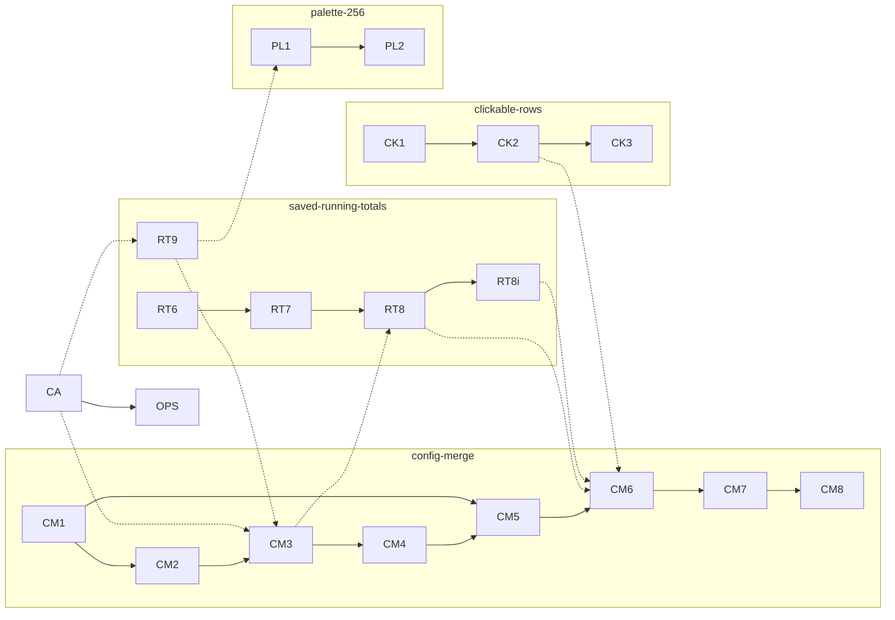

# Integrated schedule: every open plan as one task graph

The open plans' remaining steps as nodes of one graph, so agents can build
them in parallel without waiting on work they do not need or colliding in
files they both change. Written 2026-10-20 from:

- [Configuration](config-merge.md), steps 1–8: `CM1` … `CM8`.
- [Saved running totals](_implemented/saved-running-totals.md), steps 6–9
  and its Decided 5: `RT6` … `RT9`, `RT8i`. Steps 1–5 were done; every
  node is now done (2026-10-21).
- [Clickable rows](clickable-rows.md), steps 1–3: `CK1` … `CK3` (added
  2026-10-20).
- [Colours on the 256-colour palette](_implemented/palette-256.md), steps 1–2: `PL1`,
  `PL2` (added 2026-10-20).
- Work in flight outside the plans: `CA`, the calibration cache keyed by
  account id (asked 2026-10-20, Blocked.1.A).

A plan's own build order stays the reference for what each step does; this
file says only when it can start. Update it as nodes land: mark the node
done, and move a plan to [_implemented](_implemented/) when its last node is.

## How to read it

- **A node** is one step of one plan, one commit, built by one agent in its
  own worktree, rebased onto `master` before it is pushed.
- **A logical edge**, `A → B`: B needs what A builds.
- **A file edge**, `A ⇢ B`: no logical need, but both change the same part
  of one file, so B starts after A lands rather than rebasing across it.
  Two nodes that touch different functions of one file (`claude.py` is
  4,000 lines) are not linked; a rebase takes them.
- **A wave** is a set of nodes with no edge between them, started together.
  A node starts in the first wave after all its edges are done.

## The nodes

| Node | What | Logical edges in | File edges in | Main files |
|---|---|---|---|---|
| `CA` | **Done 2026-10-20 (defde44).** Calibration keyed by source, account id and window; old files swept | none (in flight) | none | `sources.py`, `claude.py` (calibration, tracker reading), `mod/src/sources.ts`, `mod/src/claude_calib.ts` |
| `CM1` | **Done 2026-10-20.** The options spec, generated | none | none | `spec/options.jsonc`, `tools/gen-spec.py`, `options_spec.{py,ts}`, `docs/options.md` |
| `CM2` | **Done 2026-10-20.** The Python parses flags from the spec | `CM1` | none | `cli.py`, `tests/port-cli.py` |
| `CM3` | **Done 2026-10-20.** The Python reads `Options`, not `argv` | `CM2` | `CA`, `RT9` | `claude.py` (every `_flag`), the Codex path |
| `CM4` | **Done 2026-10-20.** The Python reads the files | `CM3` | none | `config.py` (new), `tests/config.py`, shared config cases |
| `CM5` | **Done 2026-10-20.** The mod reads the files | `CM1`, `CM4` (its shared cases) | none | `mod/src/config.ts` (new), `mod/hooks/edges.ts` (the read), `config.test.ts` |
| `CM6` | **Done 2026-10-21.** The mod draws from `options()`; the rows table (ran before `CK2`, which rebases over it) | `CM5` | `RT8`, `RT8i` | `mod/hooks/register.tsx`, `mod/hooks/edges.ts` (every `CONFIG.x`), `mod/hooks/config.ts` |
| `CM7` | **Done 2026-10-21.** Today's settings move into files | `CM6` | none | `~/.claude/settings.json` (by hand), `.config/coding-agent-usage-line/`, `.gitignore` |
| `CM8` | The acceptance check, live | `CM7` | none | none |
| `RT6` | **Done 2026-10-20.** The cold read folds in Python | none | none | `mod/scripts/agent_lines.py`, `mod/hooks/edges.ts` (`foldOf`), `main_fold.{py,ts}` |
| `RT7` | **Done 2026-10-20.** The cut, dropped | `RT6` | none | `mod/hooks/edges.ts`, `mod/src/claude_records.ts`, `mod/scripts/agent_lines.py` |
| `RT8` | **Done 2026-10-20.** The panel on the agent folds | `RT7` | `CM3` | `claude.py` (`read_agent_usage`), `claude_records.{py,ts}` (agent fold), `spec/state.jsonc`, `mod/hooks/edges.ts` |
| `RT8i` | **Done 2026-10-21.** The inbox moves to the folds (a fold of its own, `inbox-fold`) | `RT8` | none | `claude_records.{py,ts}` (`inbox_counts`), `claude.py` (the panel's inbox) |
| `RT9` | **Done 2026-10-20.** The window costs, one file | none | `CA` | `claude.py` (`_window_costs`), `mod/src/claude_calib_node.ts`, `spec/state.jsonc` |
| `OPS` | **Done 2026-10-20.** Sweep the old `-ts-` calibration files | `CA` | none | `~/.local/state/coding-agent-usage-line/` (by hand) |
| `CK1` | **Built 2026-10-20; tried live 2026-10-21, the agent message row a plain row again (its click is Claude Code's, to expand it); 🎤's scroll still the user's to try.** The clickable-rows trial: 🎤 and the agent message row as Buttons, tried live | none | none | `mod/hooks/register.tsx` (row drawing, `UserMessage` hooks), `mod/mod-tests/` |
| `CK2` | **Done 2026-10-21** (started before the user's live click on 🎤, as they asked). The targets: `requestId`s recorded, 🎤 and 🤖 pressable in the band and the receipt | `CK1` (and the user's live report) | none | `mod/hooks/register.tsx`, `mod/src/receipt.ts` (`receiptScoped`), `mod/mod-tests/` |
| `CK3` | Docs for the pressable rows | `CK2` | none | `docs/layout.md` |
| `PL1` | **Done 2026-10-20.** Every default colour snapped to a 256-palette entry, reviewed by eye; gen-spec's check | none | `RT9` | `spec/layout.jsonc`, `tools/gen-spec.py`, `spec.{py,ts}`, every colour fixture and golden |
| `PL2` | **Done 2026-10-20.** The doc note on themes and `CLAUDE_CODE_TMUX_TRUECOLOR` | `PL1` | none | `docs/` |

`RT8`'s and `RT6`/`RT7`'s edges in the plan: steps 4 to 7 land in order,
step 8 needs steps 1 and 4 (done), step 9 needs step 1 (done).

## The graph

Solid arrows are logical edges, dotted ones file edges.

## The waves

| Wave | Nodes, in parallel | Starts when |
|---|---|---|
| 0 | `CA` | running now |
| 1 | `CM1`, `RT6` | now: neither touches `CA`'s files |
| 2 | `CM2`, `RT7`, `RT9`, `OPS` | `CM1` and `RT6` land, and `CA` for `RT9` and `OPS` |
| 3 | `CM3`, `CK1`, `PL1` | `CM2` and `RT9` land; `CK1` and `PL1` touch none of `CM3`'s files |
| 4 | `CM4`, `RT8`, `CK2`, `PL2` | `CM3` and `RT7` land, and the user's live report on `CK1` |
| 5 | `CM5`, `RT8i`, `CK3` | `CM4` and `RT8` land |
| 6 | `CM6` | `CM5`, `RT8i` and `CK2` land |
| 7 | `CM7`, then `CM8` | `CM6` lands; both by hand with the user |

At most four agents run at once (wave 4), and no two of a wave change the
same part of a file.

- **`CK2 ⇢ CM6`:** both change how `register.tsx` draws rows; the
  clickable rows go first, so `CM6` rewrites `CONFIG.x` over them.
- **`RT9 ⇢ PL1`:** `PL1` regenerates every colour fixture and golden, so
  it waits for `RT9`, the last running node that regenerates fixtures.

## The critical path

`CM1 → CM2 → CM3 → CM4 → CM5 → CM6 → CM7 → CM8`: the configuration plan is
the longest chain, and every saved-running-totals node fits beside it. Two
file edges can lengthen it:

- **`RT9 ⇢ CM3`:** `CM3` rewrites how `claude.py` reads every flag, which
  `RT9`'s `_window_costs` change sits among. If `RT9` runs late, build `CM3`
  first and rebase `RT9` across it instead.
- **`RT8`, `RT8i` ⇢ `CM6`:** `CM6` rewrites every `CONFIG.x` in
  `edges.ts`, where `RT8` moves the agent folds. If the saved-running-totals
  side runs late, `CM6` goes first and they rebase across it.

The configuration side has the right of way at each, since it is the path
that sets when everything is done.

## Live checks between waves

- After `RT6` and `RT7`: a `/reload-plugins` logs no slow read with large
  `sum`, `turns` or `records`, and `claude-main-cuts-mod/` is gone.
- After `RT8`: the panel's tick reads only new lines; its 🪫 shares match
  the band's.
- After `RT8i`: an agent's `📨` on the panel still comes and goes as
  messages queue and are delivered, and the state directory holds a
  `claude-inbox-fold-*/` for the session. The band's `📨` is the main
  thread's own queue, another count.
- After `CA`: a new session's agent rows show 🪫 shares within one tick, and
  one `claude-calibration-*.cache` serves every session of the account.
- `CM8` is the configuration plan's own acceptance list.
